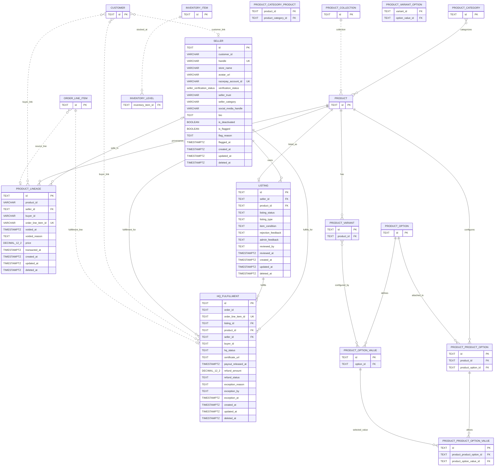

# PawnPawn Database Schema

## Scope and sources

The database is PostgreSQL, configured by `apps/backend/medusa-config.js` (`DATABASE_URL`, default database `pawnpawn_db`). Medusa 2.22 manages its commerce tables through its modules; PawnPawn adds four tables in `apps/backend/sql/schema.sql` and model files under `apps/backend/src/modules/*/models`. `apps/backend/sql/marketplace_prompt_alignment.sql` additionally writes to Medusa catalog, option, and inventory tables. The diagram focuses on the custom schema and the native Medusa tables touched or referenced by it; it is not an inventory of every table in a live Medusa installation.

`sample-data.sql` and `initial-data-seed.ts` are data seeds, not schema definitions. There are no checked-in ORM migrations or Docker/Compose database definitions in this repository. The SQL schema is idempotent and includes compatibility `ALTER TABLE` statements for databases created by earlier versions.

## Entity relationship diagram

Dashed/annotated edges are application-level references and are not enforced by custom SQL foreign keys. The join-table/link relationships for native Medusa tables are represented from the SQL alignment script; exact native columns, constraints, and cardinalities are managed by Medusa and may vary with its migrations/configuration.

## Structural summary

### Domain entities

- **Seller** stores a marketplace seller profile, payout account, verification/trust/category state, moderation flags, and soft-delete/deactivation state.
- **Listing** is the marketplace lifecycle record for a product: seller assignment, review feedback, condition, and availability/approval state. Each product can have at most one listing because `product_id` is unique.
- **Product lineage** records ownership transfers and sale price over time. `voided_at` and `voided_reason` allow invalidating a transfer without removing its audit record.
- **HQ fulfillment** tracks authentication, dispatch, delivery, payout, refunds, and exceptions per purchased order line. This allows mixed-seller orders to move independently through fulfillment.
- **Medusa catalog and commerce entities** provide Product, Customer, Order/OrderLineItem, categories, collections, product options/values, variants, and inventory. PawnPawn uses these native models instead of duplicating them.

### Relationships and integrity

- `listing.seller_id`, `product_lineage.seller_id`, and `hq_fulfillment.seller_id` reference `seller.id`; deletes are restricted for direct SQL constraints.
- `listing.product_id` references Medusa `product.id` and is unique; `hq_fulfillment.product_id` also references `product.id`.
- `hq_fulfillment.listing_id` references `listing.id`; its `order_line_item_id` is unique, enforcing at most one HQ record per order line.
- `product_lineage.seller_id` is nullable for buyer-to-buyer resales. Its product, buyer, and order-line identifiers are not declared as SQL foreign keys. `seller.customer_id`, listing review actor, order, and buyer identifiers are likewise logical references only.
- Native catalog alignment creates categories and option values and associates them with products/variants through Medusa link tables. The SQL assumes these native tables exist; it does not create them.
- Seller handle, Razorpay account ID, listing product ID, and HQ order line ID are unique. Seller `customer_id` and lineage source order line use partial unique indexes that ignore null values.

### Indexes and constraints

- Unique constraints/indexes: `seller.handle`, `seller.razorpay_account_id`, partial `idx_seller_customer_id`; partial `idx_product_lineage_order_line`; `listing.product_id`; and `hq_fulfillment.order_line_item_id`.
- Lookup indexes: seller handle, Razorpay account, verification status, trust, and category; lineage product, seller, buyer, and transaction time; composite listing `(seller_id, listing_status)`; composite HQ `(seller_id, hq_status)`.
- Check constraints restrict listing status to `PENDING_APPROVAL`, `AVAILABLE`, `SOLD`, `REJECTED`; listing type to `FIXED_PRICE`, `AUCTION`; and HQ status to the six lifecycle states in the model.
- Seller verification status is a PostgreSQL enum (`PENDING`, `VERIFIED`). Seller trust/category and HQ refund status are enum-like values in Medusa models but represented as text/varchar in the custom SQL; only the SQL-declared checks are guaranteed at the database layer here.
- Foreign key deletes from Seller, Listing, or Product are protected with `ON DELETE RESTRICT` on the custom FK declarations.

### Views

- `product_current_owner` selects the latest non-voided lineage event per product and returns the buyer as current owner plus last sale price/time. It uses `DISTINCT ON (product_id)` ordered by descending `transacted_at`.
- `seller_stats` aggregates non-voided lineage rows by seller into sales count, revenue, and most recent sale timestamp.

### Schema caveats

- Medusa models supply `created_at`, `updated_at`, and `deleted_at` on custom module tables. The standalone SQL explicitly defines these fields for the custom tables.
- The module models and raw SQL are not perfectly type-aligned: `product_lineage.buyer_id` is nullable in SQL while the model declares it non-null; `product_lineage.order_line_item_id` is varchar in SQL and model-unique, while SQL uses a partial unique index to allow nulls; and several enum-like fields have model-level enum validation but text/varchar storage in SQL.
- `customer_id`, `product_id` in lineage, `buyer_id`, and order references are logical links without local FK constraints, so referential integrity for those values depends on application flows.
- Medusa owns its broader schema and migrations. To produce a complete database-instance inventory, inspect the live PostgreSQL catalog after the matching Medusa migrations have run.
